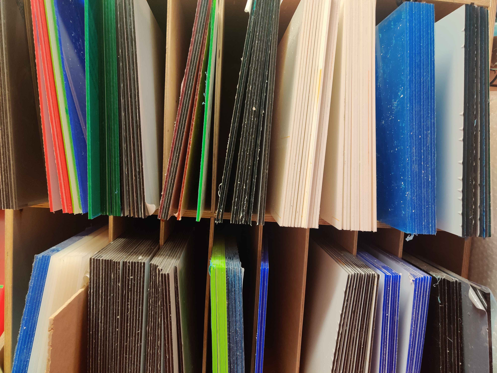

# Verð á efni

Aðgangur að Fab Lab Ísafirði er öllum að kostnaðarlausu.  Engin gjöld eru innheimt af notkun tölva né annara tækja. 
Hinsvegar eru rukkuð efnisgjöld, verð á helstu hráefnum má sjá hér að neðan:

{: style="height:60%;width:60%"}

---

## Vínyll

|    Efni    | tegund  |   Verð    |
| :--------: | :-----: | :-------: |
| Vínilfilma | cast777 | 1500 kr/m |

---

## Laser plötur

| þykt |    efni    |  verð  |
| :--: | :--------: | :----: |
| 3mm  | plexyplata | 2500kr |
| 5mm  | plexyplata | 3500kr |

---

## 3D prentun

_50 kr start gjald_

| Efni  |   Verð   |
| :---: | :------: |
|  PLA  | 15 kr/gr |
| HTPLA | 15 kr/gr |
| PETG  | 15 kr/gr |
|  TPU  | 20 kr/gr |
|  ABS  | 10 kr/gr |

---

## Rafrásarfræs

|    Efni    |  Verð  |
| :--------: | :----: |
| Koparplata | 500 kr |

_Til að viðhalda fræsitönnum tökum við 500/klst. ef eigin fræsitennur eru nottaðar er ekkert gjald._

---

## Rafbúnaður / íhlutir

Rafmagnsíhlutir eru ekki ókeypis. Miðað er við upprunalegt verð erlendis, að viðbættu sendingar- og umsýslugjaldi og virðisauka.

Verð er reiknað með eftirfarandi hætti:

**Dæmi: Seeed Studio XIAO RP2040**

Partanúmer á DigiKey: 102010428

Verð á DigiKey: $4,70 eða um 650 kr.

| Lýsing                  |        Verð |
| ----------------------- | ----------: |
| Verð á DigiKey          |     650 kr. |
| Umsýslugjald (10%)      |      65 kr. |
| Virðisaukaskattur (24%) |     172 kr. |
| **Heildarverð**         | **887 kr.** |

---

## Stór fræsivél (Shopbot)

Fer eftir verkefnum, notendur Fab Lab geta komið með eigin efni í samráði við starfsmenn.

Til að viðhalda fræsitönnum er 1000kr gjald / klst.

Ef eigin fræsitennur eru notaðar er ekkert gjald.

---
